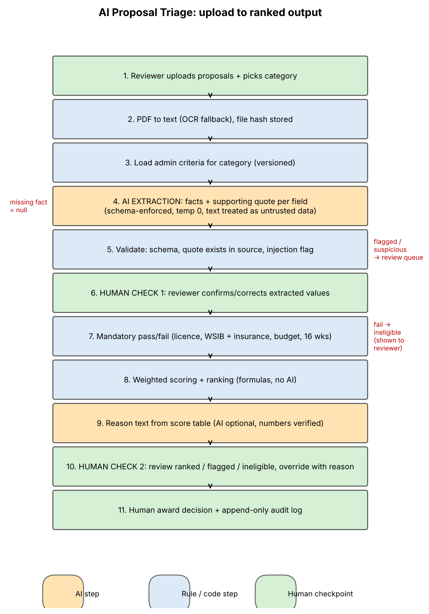

# MATACS-TH-2026-02: AI Proposal Triage Design

## Student Details

- **Name:** Fariha Ghazi
- **Reference:** MATACS-TH-2026-02
- **Time Actually Spent:** 1 Hour

## Files

- **[WRITEUP.md](WRITEUP.md):** Answers to the five questions.
- **Process Flow Diagram:** Shows the process from file upload to ranked results, including AI steps, rule-based steps, and human checkpoints.

- **[PROMPTS.md](PROMPTS.md):** Contains the prompts used for extraction and reasoning.
- **[ranking.json](ranking.json):** Contains the expected ranking of proposals A-E.
- **[prototype/](prototype/):** Contains a small scoring script that runs using `python score.py extracted.json`. The AI step is represented by the saved `extracted.json` file, so no API key is needed.

## How I Used AI Tools

I used Claude to help prepare the write-up structure, prompts, flow diagram, and scoring script. I also used it to check the scoring calculations.

I reviewed the results and made the final design decisions myself. In my design, AI only extracts facts, while eligibility checks, scoring, and ranking are handled by normal code with human checkpoints.

**One example of how I carefully reviewed AI's work:**

The AI-generated scoring script also used proposals that had been flagged when calculating price and timeline scores. This meant that a proposal not yet approved by a human could affect the scores of other proposals.

I identified this as a limitation. In a real system, I would calculate scores only using proposals that are eligible and approved by a human.
